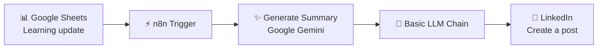

<div align="center">

### 🤖 AI Learning Journey Showcase using n8n
    Turn learning updates into AI-assisted LinkedIn content — automatically.
    A workflow automation project connecting Google Sheets, Google Gemini, n8n, and LinkedIn to help document and share a learning journey.
</div>

### 🖼️ Workflow Preview
<div align="center">
    
</div>
<div align="center">
    AI Learning Journey Showcase workflow in n8n.
</div>

### 📌 Project Overview

    Keeping a consistent record of what you learn can be difficult when updates must be rewritten and posted manually. This project explores      how workflow automation and generative AI can help streamline that process.
    Learning updates are stored in Google Sheets. The n8n workflow processes the configured data with Google Gemini and an LLM chain, then        sends the resulting content to the LinkedIn post-creation step.
    Goal: Make sharing learning progress easier while keeping the content grounded in the learning updates provided.

### 🔄 Workflow Architecture

    The exact trigger behavior and data flow depend on your saved node configuration and prompts.
### 🧩 Workflow Components
<div align="center">
    Component	Purpose
    Google Sheets Trigger	Starts the workflow when the configured sheet event occurs.
    Generate Summary	Uses the configured AI step to summarize a learning update.
    Basic LLM Chain	Processes the content using the configured prompt and language model.
    LinkedIn — Create a Post	Sends the processed content to LinkedIn using your configured account and permissions.
</div>

### 🛠️ Technology Stack
<div align="center">

</div>

    - n8n: Connects the workflow steps and services.
    - Google Sheets: Stores learning updates.
    - Google Gemini: Supports AI-powered summarization and language-model processing.
    - LinkedIn: Receives the generated post.
    - JSON: Stores the exported workflow definition.
    
### ✨ Key Highlights
    - 📚 Organizes learning updates in a familiar spreadsheet.
    - 🧠 Uses generative AI to help turn updates into readable content.
    - 🔗 Connects multiple applications in a single workflow.
    - ⚙️ Demonstrates trigger-based automation and LLM integration.
    - 📈 Supports a more consistent process for sharing learning progress.
### ⚙️ Setup and Usage
    Prerequisites
    Before importing the workflow, make sure you have:
    - An n8n instance.
    - Access to Google Sheets and a spreadsheet containing learning updates.
    - Google Gemini access and the required credentials.
    - A LinkedIn account with the permissions required by the LinkedIn node.
    Import the workflow
    1. Open this repository and download AI Learning Journey Showcase using n8n.json.
    2. Open your n8n workspace.
    3. Import the downloaded JSON workflow.
    4. Configure your own Google Sheets, Google Gemini, and LinkedIn credentials in n8n.
    5. Review the spreadsheet selection, prompts, model settings, and LinkedIn publishing configuration.
    6. Run a controlled test with non-sensitive sample content.
    7. Confirm the generated content is correct before enabling automatic publishing.

### 🔐 Security Best Practices
    - Never commit API keys, access tokens, OAuth refresh tokens, passwords, or private data.
    - Store credentials in n8n's credential manager rather than directly in node parameters.
    - Review exported JSON files before making a repository public.
    - Use a test spreadsheet and test content when validating the workflow.
    - Check AI-generated posts before publishing to avoid inaccurate or unintended content.
    - Follow Google, LinkedIn, and other connected services' terms and usage limits.
### 📂 Repository Structure
```
    ai-learning-journey-showcase-n8n/
    ├── AI Learning Journey Showcase using n8n.json
    ├── README.md
    └── LICENSE
```

### 🎓 Learning Outcomes
    Through this project, I am practising:
    - Workflow design and automation using n8n.
    - Connecting spreadsheet data to AI processing steps.
    - Working with Google Gemini and LLM chains.
    - Integrating third-party platforms.
    - Exporting, documenting, and versioning workflows with GitHub.
    - Applying security practices when sharing automation projects.
### 👨‍💻 Author
Kanithi Kali Kowsik,
    This project is part of my ongoing learning journey in AI, workflow automation, and practical technology projects.
<div align="center">
    If this project helps you learn something, consider giving the repository a ⭐
    Built with n8n · Google Sheets · Google Gemini · LinkedIn
</div>
